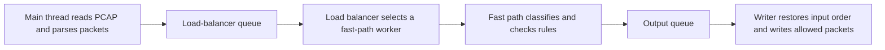

# NetSentinel-DPI

NetSentinel-DPI is a Java tool for inspecting and filtering saved PCAP network captures. It parses Ethernet, IPv4/IPv6, TCP, and UDP packets, recognizes a selection of application domains, applies blocking rules, and writes allowed packets to a new PCAP file.

This guide explains the networking concepts, packet-processing pipeline, code layout, build steps, and current limits of the project.

## Contents

- [What the engine does](#what-the-engine-does)
- [Networking basics](#networking-basics)
- [Project structure](#project-structure)
- [How a packet moves through the engine](#how-a-packet-moves-through-the-engine)
- [How classification works](#how-classification-works)
- [How blocking rules work](#how-blocking-rules-work)
- [Build and run](#build-and-run)
- [Reading the report](#reading-the-report)
- [Code guide](#code-guide)
- [Current limitations](#current-limitations)

## What the engine does

The program reads a saved capture, inspects packets, and writes packets that pass the configured rules:

```text
Input PCAP -> Parse -> Classify and check rules -> Output PCAP
```

It has two commands:

- `analyze` prints packet headers and a short payload preview.
- `dpi` classifies traffic, applies blocking rules, and writes a filtered capture.

The tool operates on files. It does not capture live traffic, change the host firewall, or decrypt application data.

## Networking basics

### Packet layers

A typical Ethernet packet wraps network and transport headers around application data:

```text
+------------------+----------------+----------------+--------------------+
| Ethernet header  | IP header      | TCP or UDP     | Application payload|
| MAC addresses    | IP addresses   | Ports, flags   | HTTP, TLS, DNS, ...|
+------------------+----------------+----------------+--------------------+
```

Ethernet identifies devices on a local network. IP addresses identify the sending and receiving hosts. TCP and UDP ports identify services or applications on those hosts. The payload may contain application metadata that helps identify a service.

### The five-tuple

The engine identifies a TCP or UDP flow using five values:

| Field | Example | Meaning |
| --- | --- | --- |
| Source IP | `192.168.1.20` | Sending host |
| Destination IP | `203.0.113.10` | Receiving host |
| Source port | `51000` | Sending endpoint |
| Destination port | `443` | Receiving service |
| Protocol | TCP (`6`) | Transport protocol |

The tuple is directional: reversing source and destination creates a different tuple. Packets with the same direction and tuple are assigned to the same worker so the engine can retain classification and blocking state for that direction of a flow.

### What DPI can see

Deep Packet Inspection means examining packet payload bytes as well as headers. This project looks for a few pieces of application metadata:

- A TLS ClientHello's Server Name Indication (SNI), commonly a hostname such as `www.example.com`.
- The `Host` header in a plain HTTP request.
- A DNS question name in a UDP DNS query.

HTTPS content is encrypted. The engine can inspect a visible TLS ClientHello hostname, but it cannot read encrypted page contents. If the hostname is unavailable in the capture, the engine falls back to the IP address and port rules it can evaluate.

## Project structure

```text
Packet_analyzer/
├── README.md
├── generate_test_pcap.py       # Optional sample-capture generator
├── test_dpi.pcap               # Sample capture used in the commands below
└── java/
    ├── build.ps1               # Compiles sources and creates the executable JAR
    ├── run.ps1                 # Builds on demand, then runs the JAR
    ├── README.md
    └── src/main/java/com/packetanalyzer/
        ├── PacketAnalyzer.java # CLI commands and packet display
        ├── PcapFile.java       # Classic PCAP reader and writer
        ├── PacketParser.java   # Ethernet, IP, TCP, and UDP parsing
        ├── FiveTuple.java      # Directional flow key
        ├── DpiEngine.java      # Worker pipeline, inspection, output, and report
        ├── SniExtractor.java   # TLS SNI, HTTP Host, and DNS query parsing
        ├── RuleManager.java    # Rule loading, matching, and saving
        └── AppType.java        # Domain-to-application classification
```

The build creates `java/build/classes/` and `java/build/netsentinel-dpi.jar`. These are generated outputs.

## How a packet moves through the engine

The DPI command uses bounded queues and worker threads. By default it starts two load balancers, each with two fast-path workers.



1. **Read and parse:** The main thread reads each record from the PCAP file. Ethernet packets are parsed into addresses, protocol, ports, and payload offsets.
2. **Select a worker:** A hash of the directional five-tuple selects a load balancer and then one of its fast-path workers. Packets without a TCP/UDP tuple are distributed by packet number.
3. **Inspect:** The fast-path worker keeps per-flow state, tries to identify the application, and checks the configured rules.
4. **Queue the result:** The worker sends a forward-or-drop decision to the output queue.
5. **Write in capture order:** Workers can finish at different times. The writer buffers results by packet number and writes allowed packets in their original order.

Queues have a fixed capacity, which applies backpressure when a downstream stage is busy. The total number of fast-path workers (`--lbs` multiplied by `--fps`) cannot exceed 64.

## How classification works

The engine uses the parsed protocol and destination port to decide which payloads to inspect:

| Traffic | Inspection |
| --- | --- |
| TCP destination port 443 | Attempts to extract a TLS ClientHello SNI and map its hostname to an application |
| TCP destination port 80 | Attempts to extract the HTTP `Host` header and map its hostname |
| UDP source or destination port 53 | Labels the flow as DNS; extracts a query name when the destination port is 53 |
| UDP destination port 443 | Labels the flow as QUIC; it does not inspect QUIC contents |
| Other TCP/UDP traffic | Uses the port-based HTTP/HTTPS fallback where applicable, otherwise remains unknown |

Recognized domain signatures include Google, Facebook, YouTube, Twitter/X, Instagram, Netflix, Amazon, Microsoft, Apple, WhatsApp, Telegram, TikTok, Spotify, Zoom, Discord, GitHub, and Cloudflare. These are string-based signatures in `AppType.java`, not a complete or authoritative application database.

Once a flow is classified, its application and domain are retained for subsequent packets in that directional tuple. The engine does not reassemble TCP streams, so a ClientHello or HTTP header split across packets may not be recognized.

## How blocking rules work

The engine checks rules in this order:

1. Source IP address
2. Destination port
3. Classified application
4. Extracted domain

When a rule matches a flow, the flow is marked blocked and later packets with that same directional tuple are dropped. Packets sent in the reverse direction have a different tuple and do not share that state.

| Rule | Example | Matching behavior |
| --- | --- | --- |
| Source IP | `--block-ip 192.168.1.50` | Matches the packet's source address |
| Destination port | `--block-port 23` | Matches the packet's destination port |
| Application | `--block-app YouTube` | Matches a recognized application name |
| Domain | `--block-domain tiktok` | Matches a case-insensitive substring in the extracted domain |
| Domain wildcard | `--block-domain "*.example.com"` | Matches `example.com` and its subdomains |

Rules can be passed on the command line or loaded from a text file. Command-line rules are added to rules loaded from the file.

Example `blocking_rules.txt`:

```ini
# Lines beginning with # or ; are comments.
[BLOCKED_IPS]
192.168.1.50

[BLOCKED_APPS]
YouTube

[BLOCKED_DOMAINS]
*.tiktok.com

[BLOCKED_PORTS]
23
```

## Build and run

### Requirements

- JDK 11 or newer
- PowerShell

The Java application uses only the standard library. Maven, Gradle, and downloaded dependencies are not required.

### Build

From the `Packet_analyzer` folder:

```powershell
cd java
.\build.ps1
```

The executable JAR is written to `java/build/netsentinel-dpi.jar`.

### Analyze a capture

From the `java` folder, print the first 10 packets:

```powershell
.\run.ps1 analyze ..\test_dpi.pcap 10
```

Omit the packet limit, or use `0`, to read the entire capture:

```powershell
.\run.ps1 analyze ..\test_dpi.pcap
```

The command prints capture metadata, Ethernet/IP/TCP/UDP fields, and up to 32 payload bytes in hexadecimal for each packet.

### Filter a capture

Write a new capture while blocking YouTube:

```powershell
.\run.ps1 dpi ..\test_dpi.pcap ..\filtered.pcap --block-app YouTube
```

More examples:

```powershell
.\run.ps1 dpi ..\test_dpi.pcap ..\filtered.pcap --block-ip 192.168.1.50
.\run.ps1 dpi ..\test_dpi.pcap ..\filtered.pcap --block-domain "*.tiktok.com"
.\run.ps1 dpi ..\test_dpi.pcap ..\filtered.pcap --block-port 23
.\run.ps1 dpi ..\test_dpi.pcap ..\filtered.pcap --rules ..\blocking_rules.txt
```

The input and output paths must be different. The input capture is read, and allowed packets are written to the output path.

### DPI options

| Option | Default | Description |
| --- | --- | --- |
| `--block-ip <ip>` | None | Block packets from a source IP address |
| `--block-port <port>` | None | Block packets sent to a destination port |
| `--block-app <name>` | None | Block a recognized application |
| `--block-domain <text>` | None | Block a matching extracted domain |
| `--rules <file>` | None | Load rules from a sectioned rules file |
| `--lbs <n>` | `2` | Number of load-balancer workers |
| `--fps <n>` | `2` | Fast-path workers per load balancer |
| `--queue-size <n>` | `10000` | Capacity of each worker queue |
| `--verbose` | Off | Print packet actions and worker dispatch counts |

Thread and queue values must be positive integers. `--lbs` multiplied by `--fps` must be 64 or less.

## Reading the report

After a DPI run, the report includes:

- **Total packets and bytes:** Records read from the input capture.
- **TCP, UDP, and other packets:** Counts based on successfully parsed transport headers.
- **Forwarded and dropped packets:** Decisions made by the rules engine.
- **Application breakdown:** Packet counts grouped by the engine's classification.
- **Detected domains/SNIs:** Hostnames extracted from TLS, HTTP, or DNS payloads.
- **Rules loaded:** Number of IP, application, domain, and port rules active for the run.

Application counts are packet counts, not unique flows. With `--verbose`, the program also prints packet decisions and per-worker dispatch totals.

The output PCAP retains the input capture's byte order, timestamp precision, link type, global-header values, packet timestamps, and packet bytes for each forwarded packet.

## Code guide

| File | Responsibility |
| --- | --- |
| `PacketAnalyzer.java` | Parses command-line arguments and implements `analyze` and `dpi` commands |
| `PcapFile.java` | Reads and writes classic PCAP global and packet headers |
| `PacketParser.java` | Parses Ethernet, VLAN tags, IPv4/IPv6, TCP, and UDP fields |
| `FiveTuple.java` | Stores the directional source/destination addresses, ports, and protocol |
| `DpiEngine.java` | Runs worker queues, keeps flow state, applies rules, writes output in order, and prints the report |
| `SniExtractor.java` | Extracts TLS SNI, HTTP Host, and DNS query names from packet payloads |
| `RuleManager.java` | Loads, saves, validates, and matches blocking rules |
| `AppType.java` | Maps known domain strings to application labels |
| `build.ps1` | Compiles Java sources for Java 11 and packages the executable JAR |
| `run.ps1` | Starts the application and builds the JAR if it is missing |

## Current limitations

- The tool processes saved classic PCAP files; it does not capture live traffic or enforce rules on a network interface.
- Packet inspection is designed for Ethernet captures. Other PCAP link types receive limited packet summaries and are not decoded into IP/TCP/UDP flows.
- It does not read PCAPNG files.
- It does not decrypt TLS or inspect encrypted HTTP content. SNI may also be unavailable in captures where the hostname is hidden or absent.
- It does not reassemble fragmented IP packets or TCP streams. Payload data split across packets can therefore evade hostname extraction.
- Application identification uses a small set of substring signatures and can misclassify unknown or shared infrastructure domains.
- IP rules match source addresses, and port rules match destination ports. Reverse-direction packets are separate flows.
- QUIC traffic is labeled by UDP destination port 443; its encrypted contents are not inspected.
